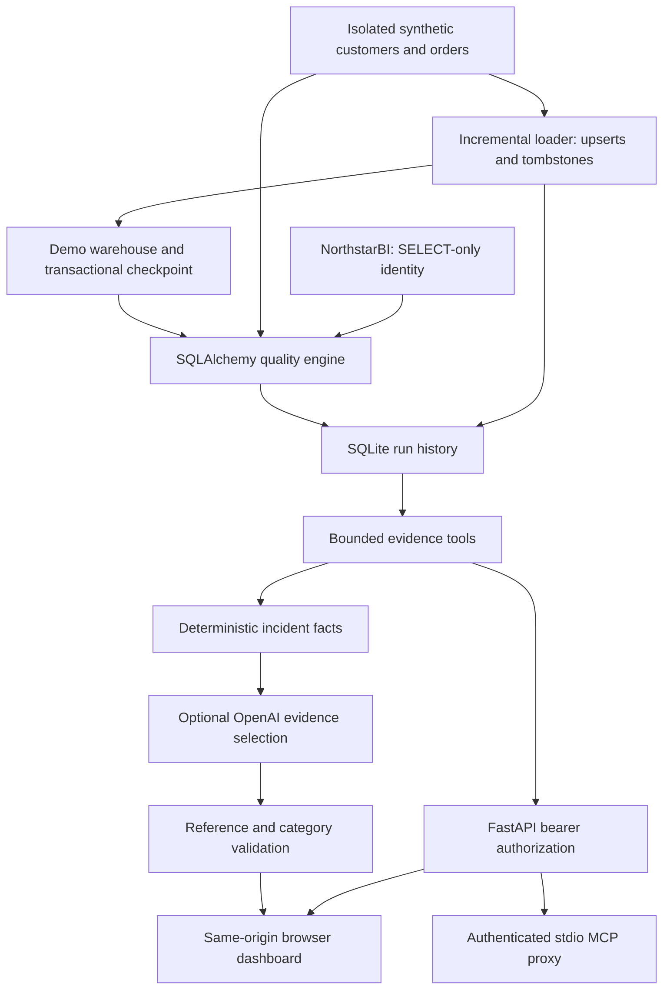

# System and data flow

Northwatch is a single-host monitoring application. It separates source access, deterministic checks, demonstration ingestion, metadata, diagnostics, and presentation. Business users can see whether reporting inputs meet explicit contracts; engineers receive reproducible evidence and safe investigation steps.

## Data ownership

`source.py` creates source readers and verifies scheduled SQL identities. `quality.py` runs aggregate SELECTs; rule files contain no SQL. `demo.py` alone writes synthetic source/warehouse data, under `data/demo/<allowlisted scenario>.sqlite`. `store.py` owns `monitoring.sqlite`, never NorthstarBI. Neither API nor MCP exposes loading, SQL execution, or incident injection.

SQLite was chosen for transparent local persistence, no server overhead, and reproducible tests. SQLAlchemy handles source SQL Server dialect translation and reflection. Pandas and Streamlit are unnecessary for these aggregate checks; a same-origin HTML/JavaScript dashboard avoids a second service and dependency tree. The official MCP SDK supplies a real stdio transport.

## Pipeline semantics

Each demo pipeline has a stable name and isolated source database. The synthetic source maintains a strictly increasing integer change version. The loader reads versions after its checkpoint, upserts by primary key, applies explicit deletion tombstones, and advances the checkpoint in the **same SQLite transaction** as target changes. Retry failures roll the transaction back. Replays process zero additional records. This requires monotonically increasing versions; late updates using old versions are outside the contract.

Execution metadata uses a unique partial index to prevent two active runs with the same pipeline name. The database records a running row before execution, then atomically records results and final status. There is intentionally no automatic stale-lock expiry. After a crash, an operator verifies the process stopped, then uses `recover`. A crash after the target commit but before metadata completion is recovered by idempotent rerun; run metadata and demo target are not a distributed transaction.

Two retries use short exponential delays. Metadata records retries, start/finish, elapsed time, changed records, errors and result IDs. `success` means all checks pass; `warning` means non-failing warnings; `failed` covers execution errors or failing quality gates. The demo loads before validating; a failed check does not roll back already-loaded demo data. This is monitoring, not a quarantine gate.

The first anomaly check warns because no baseline exists. Later checks compare to the last successful or warning run of that pipeline. Failed runs do not replace the baseline. All times are stored as UTC ISO strings; dashboard dates use the browser's locale. There is no scheduler by default; run CLI commands through a reviewed cron/Task Scheduler entry when needed.

## Extending integrations

New adapters should call `Store.start`, execute a bounded operation, then `Store.finish`. They must supply stable pipeline names and distinguish observed execution from imported evidence. There is no implemented Fabric, ADF, or SQL Agent execution-history connector. Viewing SQL Agent job names during discovery does not constitute monitoring those jobs.

## Bounds and tradeoffs

One API worker, one host, at most 100 pipelines in summary, 100 checks per rule set, 100 results per tool and 256 KiB per tool response. Run history has paginated access. Quality checks execute sequentially, each source query has a timeout; a large rule set may take longer than one query timeout. Checks are separate reads, not a cross-table snapshot: reconcile during a stable load window or provide a DBA-approved snapshot design. Schema drift compares names, normalized type families and nullability, not precision/length/indexes. Reconciliation compares aggregate sums and cannot prove row-level equality. SQL Server permissions are enforced by the database; Python checks are defense in depth.
