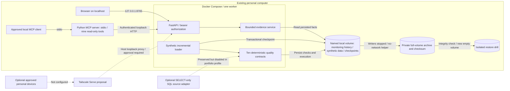

# Northwatch — private local portfolio architecture

The local profile has no cloud host and no model-provider connection. The optional
AI implementation remains available in source but its key/model are empty in this
profile. Source connectivity likewise remains implemented but disabled for synthetic
demonstrations. Tailscale is a proposal only; its eventual reverse proxy would target
the host's loopback HTTP service, not add a public Docker listener. Azure is postponed.

Authoritative facts come from persisted run/check records. Hypotheses are labeled
unconfirmed; absent values remain unavailable. Authentication stays in the API;
MCP has no SQL/shell/action tool. The host administrator remains privileged. Local
storage is durable across container replacement, not high availability or an off-host
backup. No tenant isolation, production SLA or external exposure is claimed.
